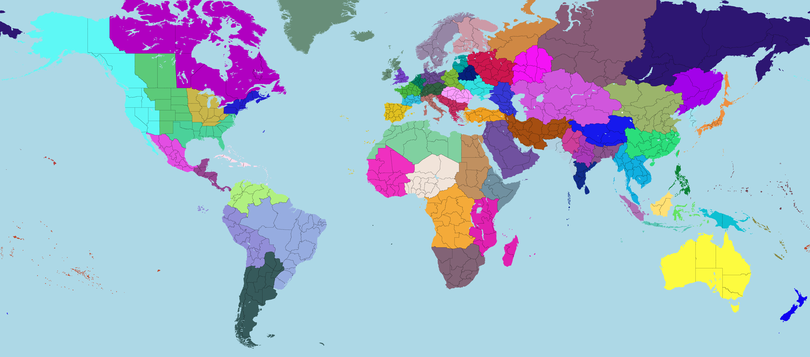

# Victoria 3 States Merging Mod (Aggressive Version)

[简体中文](documentation/README_zh-CN.md)

Pretty self-explanatory mod name. This mod combines multiple states in the game Victoria 3 together while keeping the overall pop & buildings unchanged.

**WARNING**: Due to the aggressive merging, **MOST** vanilla game experience, like journal entries and releasable countries, **WILL NOT BE GUARANTEED**.

Barracks & naval base cap as well as taxation which were reduced due to less number of states will be compensated (partially) by granting state buffs.

Speaking of buffs, they were given according to how many vanilla states they merged, except several ultra-minor states that don't deserve being a state at all (no offense).

Merged states WILL LOSE THEIR CITY & BUILDING MODELS.

Merged states WILL LOSE THEIR STATE ID, which may cause problems with certain journal entries and such. please report issues when you encounter them.

## Currently Merged States

Please refer to [merge_states.json](merge_states.json) for all the changes in states.

The keys of the json are the state id of the existing states in the mod, and the values are lists of state ids in vanilla game that will be merged into the key state.

## Installation

- Subscribe to the mod on [Steam Workshop](https://steamcommunity.com/sharedfiles/filedetails/?id=3553174702).
or
- Download the mod from [Paradox Mods](https://mods.paradoxplaza.com/mods/113894/Any).
or
- Download the mod zip file and extract it to your Victoria 3 mod folder (typically located at `Documents\Paradox Interactive\Victoria 3\mod`).

## Feedback

If you have any feedback, please refer to the [original version](https://github.com/ShabbyGayBar/StateMerging) of this mod.

## Compatability

Incompatible with anything that modifies
- common\history\buildings\
- common\history\pops\
- common\history\states\
- map_data\state_regions\

Other modified files that doesn't affect gameplay as much

- common/ai_strategies
- common/buildings
- common/character_templates
- common/coat_of_arms/template_lists
- common/company_types
- common/country_creation
- common/country_definitions
- common/country_formation
- common/decisions
- common/dynamic_country_map_colors
- common/dynamic_country_names
- common/geographic_regions
- common/flag_definitions
- common/history/countries
- common/history/global
- common/history/diplomatic_plays
- common/history/military_formations
- common/journal_entries
- common/mobilization_options
- common/on_actions
- common/political_movements
- common/scripted_buttons
- common/scripted_effects
- common/scripted_progress_bars
- common/scripted_triggers
- events
- events/agitators_events
- events/american_civil_war
- events/balkans_events
- events/brazil
- events/iberia_events
- events/india_events
- events/japan_events
- events/soi_events
- gfx/map/city_data/city_types

## Related Links

- If you prefer to merge **LESS** states, please check out the **original version** of this mod on:
  - [Github](https://github.com/ShabbyGayBar/StateMerging), or
  - [Steam Workshop](https://steamcommunity.com/sharedfiles/filedetails/?id=3371693463), or
  - [Paradox Mods](https://mods.paradoxplaza.com/mods/120868/Any).
- If you prefer to merge **EVEN LESS** states, please check out the **minimal version** of this mod on:
  - [Github](https://github.com/ShabbyGayBar/StateMergingMinimal), or
  - [Steam Workshop](https://steamcommunity.com/sharedfiles/filedetails/?id=3432100126), or
  - [Paradox Mods](https://mods.paradoxplaza.com/mods/113894/Any).
- If you prefer to make your own states merging mod, please check out the [State Merger](https://github.com/ShabbyGayBar/StateMerger).

## Acknowledgments

Special thanks to user [思考的肾结核](https://steamcommunity.com/profiles/76561198104682926) who wrote the [original version](https://steamcommunity.com/sharedfiles/filedetails/?id=3254683348) of this mod.

## License

This mod is under [MIT LICENSE](LICENSE).
